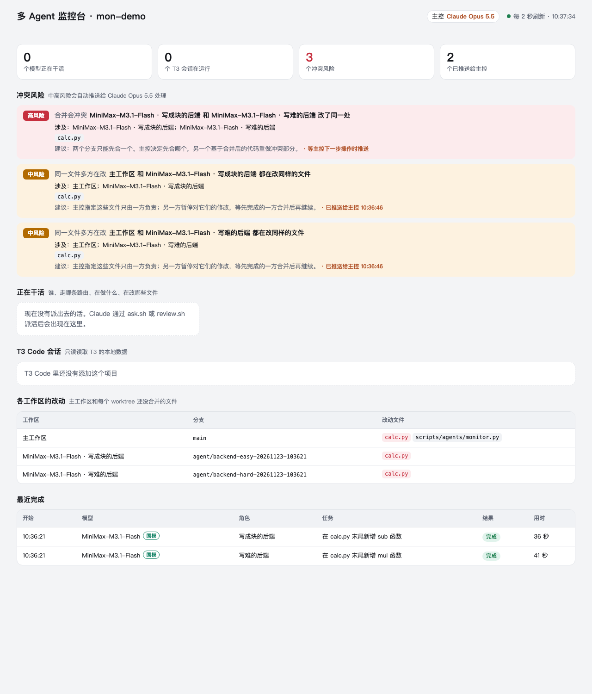

# agent-conflict-guard

Conflict detection and live monitoring for parallel AI coding agents.

When an orchestrating model dispatches work to several coding agents at once (different
models, different worktrees), nothing tells it that two of them are editing the same code until
a merge fails. agent-conflict-guard watches every parallel workspace, predicts merge conflicts
before anyone merges, and routes the risks back to the orchestrator so it can re-plan.

It runs beside [T3 Code](https://github.com/pingdotgg/t3code), Claude Code and Codex without
modifying them, and uses only the Python standard library.



## What it does

- **Sees every agent.** Which model is working, in which role, through which route
  (e.g. orchestrator → Codex CLI → local gateway → MiniMax), and which files it is changing
  right now, read from its worktree rather than from its own report.
- **Predicts conflicts before merging.** Simulates merges with `git merge-tree --write-tree`,
  which never touches a working tree, and warns on shared files while agents are still editing.
- **Routes risks to the orchestrator.** New high and medium risks are injected into the
  orchestrator's context through a Claude Code hook, or sent to its T3 Code thread with
  `t3 thread send`. Each risk is delivered once, and again only if it comes back after being resolved.
- **Reads T3 Code sessions.** Threads, models, run status and recent steps, read-only from T3's
  local store, with graceful degradation when its schema changes.

## Results

Synthetic experiment, 300 scenarios with 2–5 parallel agents
([method](experiments/README.md), [full results](experiments/results/summary.md)):

1,037 agent branches, 190 of which hit a real conflict when merged in order.

| Early warning, before any merge | Precision | Recall | False-alarm rate |
|---|---|---|---|
| "Touches the same file" (common heuristic) | 0.359 | 1.000 | 0.400 |
| Pairwise merge simulation (this project) | 1.000 | 1.000 | 0.000 |

- Of 837 branch pairs that touched a common file, only 233 (27.8%) actually conflicted.
  File overlap alone would have raised 339 false alarms; merge simulation raised none.
- At merge time, `merge-tree HEAD <branch>` agreed with the real `git merge` in all 1,037 merges.
- One full check takes about 0.14 s with 2 live worktrees and 1.9 s with 16; cost grows
  quadratically because every pair is simulated.

These numbers come from synthetic edits, where conflicts arise between pairs of branches by
construction. Real agent output is messier; see the
[threats to validity](experiments/README.md#threats-to-validity).

## Quick start

Requirements: Python 3.9+, git 2.38+ (for `merge-tree --write-tree`).

```bash
# install the kit and the monitor into a project
kit/install.sh /path/to/your/project
cd /path/to/your/project

# live dashboard at http://127.0.0.1:4317
python3 scripts/agents/monitor.py serve

# one-off check in the terminal; --strict exits 1 on high risk (useful before merging or in CI)
python3 scripts/agents/monitor.py check --strict

# deliver alerts to the orchestrator's T3 Code thread (works with any provider)
python3 scripts/agents/monitor.py watch --t3-thread <thread-id>
```

`install.sh` also merges two hooks into the project's `.claude/settings.json`
(`PostToolUse` on `Bash`, and `UserPromptSubmit`), which deliver alerts to Claude Code.

## Conflict rules

| Rule | Signal | Level |
|---|---|---|
| Merge simulation | `merge-tree` reports a conflict between a branch and HEAD, or between two branches | high (certain) |
| Shared files | two workspaces change the same path, including uncommitted edits | high if both live, else medium |
| Same directory | two live T3 threads write in one directory without worktree isolation | high |
| Task scope | two live write tasks name the same paths in their task files | medium |
| Interrupted | an agent process died without finishing | low |

Design notes, constraints and known limitations: [docs/design.md](docs/design.md).

## Related work

The core technique is not new, and this project builds on it.

- **Speculative merging.** Crystal (Brun, Holmes, Ernst and Notkin,
  [FSE 2011](https://homes.cs.washington.edu/~mernst/pubs/vc-conflicts-fse2011.pdf)) performs merges
  in the background to report conflicts between developers early. Palantír and Microsoft's
  [ConE](https://arxiv.org/abs/2101.06542) study awareness of concurrent edits at scale.
- **Commercial tools.** GitKraken's
  [Conflict Prevention](https://help.gitkraken.com/gitkraken-desktop/conflict-prevention) warns when
  teammates change the same files.
- **Parallel AI agents.** [Clash](https://github.com/clash-sh/clash) applies `git merge-tree` to all
  worktree pairs for Claude Code, Codex and Cursor, and can check each file write before it happens
  through a `PreToolUse` hook. If you only need per-agent conflict checks, use Clash.
- **Pre-write coordination.** [Claim Plane](https://arxiv.org/abs/2607.21909) and
  [ATM](https://arxiv.org/abs/2607.00041) check agents' planned changes before code is written.
- **Data.** [AgenticFlict](https://arxiv.org/abs/2604.03551) reports textual merge conflicts in
  27.67% of over 107K pull requests opened by AI coding agents.

What this project adds on top: conflicts are routed to the **orchestrating model**, which assigns
the work and can re-plan, rather than to the agent about to edit; it monitors a **multi-model**
setup (which model, through which route, changing which files); and it integrates with
**T3 Code** sessions (reading threads, detecting threads sharing a directory, delivering alerts with
`t3 thread send`). The synthetic experiment confirms, for agent-style edits, the known gap between
"same file" heuristics and merge simulation; it is not a new finding.

## The multi-model kit

`kit/` contains the workflow this monitor was built for: a Claude orchestrator that sends
planning and UX review to Gemini, Chinese copy review to Kimi, well-specified backend work to
MiniMax, harder backend work and final review to GPT, and a pre-review to DeepSeek, each in its
own worktree. See [kit/CLAUDE.md](kit/CLAUDE.md) and the
[architecture diagram](docs/images/architecture-9x16-light.png).
The kit's dispatch scripts write the events the monitor reads; the monitor also works without
them, from git and T3 Code state alone.

## Development

```bash
python3 -m unittest discover -s tests -t tests -v
python3 experiments/run_experiment.py --scenarios 300 --seed 42
```

Tests build real throwaway git repositories and a fixture T3 database; no network or models are used.

## Status and limitations

Version 0.1. Tested on macOS with git 2.50 and Python 3.15. The T3 Code reader depends on an
internal schema of a nightly build and has been tested against a fixture database and a real
T3 store with idle threads, not yet a live running turn. See
[docs/design.md](docs/design.md#known-limitations).

## License

MIT
